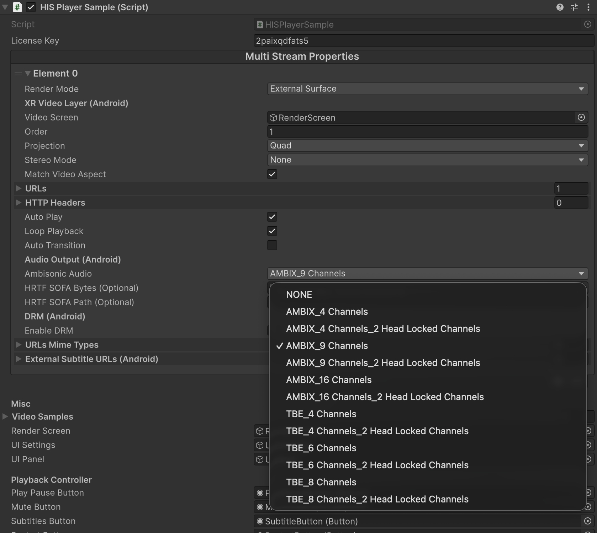

# Ambisonics Audio

HISPlayer SDK supports Ambisonics audio with ambiX format from first order to 3rd order, and TBE format to capture sound in all directions. 
It supports headset rotation listener, so the ambisonics audio is locked to the game world when users move the headset around. 

## Requirements
#### Unity version
- Supported Unity versions: Unity 6

It’s required to set **AmbisonicAudio** property in MultistreamProperties through Unity editor. 

* Ambisonics audio cannot be combined with [UnityAudio](./audio-retrieval.md) usage. 
* Only Opus audio codec is supported. Opus is the recommended codec for Ambisonic audio.
* MKV video container is recommended.
* Recommended audio sample rate is 48000Hz.
* Multistream mode with ambisonics is not supported.

For more details, please refer to below APIs section.

## Personalized HRTF Ambisonic
HISPlayer SDK supports personalized HRTF Ambisonic by setting `HRTF SOFA Bytes` or `HRTF SOFA Path`. 
Personalized HRTF support only when `Ambisonic Audio` value is between `AMBIX_4_Channels` and `AMBIX_16Channels_2HeadLockedChannels`.
* **HRTF SOFA Bytes**: SOFA file (SimpleFreeFieldHRIR, e.g. a personalised HRTF) added to the project with the extension renamed from .sofa to .bytes. Included in the build. When set, ambiX audio is rendered with this HRTF. Used instead of HRTF SOFA Path when both are set. When both are not set default HRTF will be used.
* **HRTF SOFA Path**: Path of a SOFA file (SimpleFreeFieldHRIR, e.g. a personalised HRTF) in the device file system, e.g. under Application.persistentDataPath. When set, ambiX audio is rendered with this HRTF. Files inside the project/APK are not plain files: use HRTF SOFA Bytes for those. Ignored when HRTF SOFA Bytes is set. When both are not set default HRTF will be used.

If the `Ambisonic Audio` value is not between `AMBIX_4_Channels` and `AMBIX_16Channels_2HeadLockedChannels`, or if loading SOFA fails, or if both `HRTF SOFA Bytes` and `HRTF SOFA Path` are empty, fall back to default HRTF data.

## Related APIs

**public enum HISPlayerAmbisonicAudio**: Type of ambisonics audio format:
   * **NONE**: No ambisonics audio
   * **AMBIX_4Channels**: 4 channels of first order ambiX
   * **AMBIX_4Channels_2HeadLockedChannels**: 4 channels of first order ambiX with 2 channels of head-locked audio
   * **AMBIX_9Channels**: 9 channels of second order ambiX
   * **AMBIX_9Channels_2HeadLockedChannels**: 9 channels of second order ambiX with 2 channels of head-locked audio
   * **AMBIX_16Channels**: 16 channels of third order ambiX
   * **AMBIX_16Channels_2HeadLockedChannels**: 16 channels of third order ambiX with 2 channels of head-locked audio
   * **TBE_4Channels**: 4 channels of hybrid TBE ambisonics
   * **TBE_4Channels_2HeadLockedChannels**: 4 channels of hybrid TBE ambisonics and 2 channels of head-locked stereo audio
   * **TBE_6Channels**: 6 channels of hybrid TBE ambisonics
   * **TBE_6Channels_2HeadLockedChannels**: 6 channels of hybrid TBE ambisonics and 2 channels of head-locked stereo audio
   * **TBE_8Channels**: 8 channels of hybrid TBE ambisonics
   * **TBE_8Channels_2HeadLockedChannels**: 8 channels of hybrid TBE ambisonics and 2 channels of head-locked stereo audio

**public HISPlayerAmbisonicAudio AmbisonicAudio**: Ambisonics audio supporting ambiX format from first order to 3rd order, and TBE format. Enabling Ambisonic will disable Unity Audio. It's set to None or disabled by default. To modify this value, please use the Editor.
**public bool LoadHRTF(int playerIndex, string sofaPath)**: 
Loads an HRTF from a SOFA file (SimpleFreeFieldHRIR, e.g. HUTUBS) for the custom HRTF
**public bool LoadHRTF(int playerIndex, byte[] sofaData)**: Loads an HRTF from the contents of a SOFA file.
**public Task<bool> LoadHRTFAsync(int playerIndex, string sofaPath)**: Loads an HRTF from a SOFA file on a worker thread.
**public Task<bool> LoadHRTFAsync(int playerIndex, byte[] sofaData)**: Loads an HRTF from the contents of a SOFA file on a worker thread.
